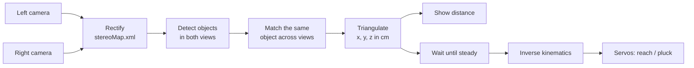

# Stereo Vision Fruit-Picking Robot

Two cameras see an object, work out where it is in 3D, and a robot arm on a
Raspberry Pi reaches for it. In fruit-picking mode the arm grips the fruit,
twists it off, and drops it in a basket.

Detection uses SSD MobileNet v3 trained on COCO, so it recognises 80 everyday
objects. Depth comes from triangulating the object's position in the left
and right camera images.

> **Status:** the code is complete and tested without hardware (15 unit tests,
> simulated servos, synthetic calibration). It has not yet run on a real camera
> rig. The committed `stereoMap.xml` comes from an old, failed calibration and
> must be redone before distances can be trusted. See [Calibration](#calibration).

## Contents

- [How it works](#how-it-works)
- [Hardware](#hardware)
- [Installation](#installation)
- [Try it without hardware](#try-it-without-hardware)
- [Calibration](#calibration)
- [Running](#running)
- [Fruit picking](#fruit-picking)
- [Configuration](#configuration)
- [Project layout](#project-layout)
- [Troubleshooting](#troubleshooting)
- [Limitations and ideas](#limitations-and-ideas)

## How it works



1. **Rectify.** Calibration produces maps that undistort both images and
   align them so that any point appears on the same row in both views.
2. **Detect.** The SSD MobileNet v3 network finds objects in each view.
3. **Match.** An object in the left view is paired with the same class in
   the right view on nearly the same row, further to the left.
4. **Triangulate.** The horizontal shift between the views (the disparity)
   gives the depth: `depth = baseline × focal_length / disparity`. The
   object's x and y follow from where it sits in the image.
5. **Act.** Once the object holds still for 5 frames, inverse kinematics
   turns its position into servo angles and the arm moves.

## Hardware

| Part | Notes |
|------|-------|
| 2 cameras | Two ESP32-CAMs on Wi-Fi (the default) or two USB webcams. Same model, mounted side by side a few cm apart, pointing the same way, rigidly fixed. |
| Raspberry Pi | Runs the scripts and drives the servos. Any desktop also works for everything except the servos. |
| PCA9685 servo driver | 16-channel I²C board, driven through Adafruit ServoKit. |
| 4 servos | Base (channel 0), shoulder (1), gripper (2), elbow (3). |
| 2-link arm | Upper arm 25 cm, forearm 17 cm by default, so it reaches 8–42 cm from the shoulder. |
| Printed chessboard | 9×6 inner corners (10×7 squares), glued flat, for calibration. |

## Installation

Requires Python 3.9 or newer. Tested with Python 3.14, OpenCV 5.0 and
NumPy 2.5. The code is written to work with OpenCV 4 as well, but that has
not been tested.

Create a virtual environment inside the project and install into it:

```bash
git clone <this repository>
cd stereoVision
python -m venv .venv
```

Activate it (do this in every new terminal):

```bash
.venv\Scripts\Activate.ps1        # Windows PowerShell
.venv\Scripts\activate.bat        # Windows cmd
source .venv/bin/activate         # Raspberry Pi / Linux / macOS
```

Install the dependencies:

```bash
pip install -r requirements.txt
pip install adafruit-circuitpython-servokit     # only on the Raspberry Pi
```

If PowerShell refuses to run the activation script, allow local scripts once:

```powershell
Set-ExecutionPolicy -Scope CurrentUser RemoteSigned
```

## Try it without hardware

These work with no cameras or servos connected.

```bash
# Run the test suite: depth maths, matching, kinematics, the pluck sequence
python -m unittest discover tests

# Check the calibration file (the committed one fails, as expected)
python stereo_calibration/check.py --no-show

# Print the servo angles for plucking a fruit 28 cm ahead, 5 cm up
python -c "import numpy as np; from stereo_vision.arm import Arm; Arm(dry_run=True).pluck(np.array([0, -5, 28]))"
```

The live programs need both cameras. Without them they keep printing a
connection error and waiting.

## Calibration

Calibration is a separate tool in [`stereo_calibration/`](stereo_calibration/README.md).
It must be done once per camera rig, and again whenever a camera moves,
rotates or is refocused.

```bash
python stereo_calibration/capture.py     # 1. save 20-30 chessboard pairs
python stereo_calibration/calibrate.py   # 2. calibrate each camera, then the pair
python stereo_calibration/check.py       # 3. must print "calibration looks good"
```

1. **Capture.** Measure one chessboard square and set `CHESSBOARD_SQUARE_CM`.
   Press `s` to save a pair when the status bar shows `L:ok R:ok`. Move the
   board around the whole view, near and far, tilted different ways, and hold
   it still to avoid blur.
2. **Calibrate.** First each camera is calibrated on its own (`--stage mono`,
   writes `left_camera.yml` and `right_camera.yml`). Then the pair is
   calibrated together (`--stage stereo`, writes `stereoMap.xml`). The script
   prints the error, the field of view and the measured baseline, and names
   the worst images. Below 0.5 px is good. Delete the worst images and rerun
   if it is higher.
3. **Check.** Confirms the maps are not warped and that the same chessboard
   corner lands on the same row in both views. `--live` shows the rectified
   cameras with guide lines.

Copy the measured baseline into `BASELINE_CM` afterwards.

## Running

Run everything from the repository root. Press `q` or `Esc` to quit a
live window.

| Command | What it does |
|---------|--------------|
| `python scripts/stereoVision.py` | Shows every detected object with its distance. |
| `python scripts/stereoVision.py --objects bottle cup` | Only bottles and cups. |
| `python scripts/stereoVisionsecure.py --object bottle --dry-run` | Moves the arm to the closest bottle; `--dry-run` only prints the servo angles. |
| `python scripts/fruit_picker.py --dry-run` | Fruit picking, printing moves only. |
| `python scripts/fruit_picker.py --fruits apple --max-picks 3` | Pick up to three apples. |

Every script accepts `--help`. Object names must match the COCO labels in
[`models/coco.names`](models/coco.names), for example `bottle`, `cup`,
`apple`. Quote names with a space: `--objects "cell phone" "sports ball"`.

## Fruit picking

`fruit_picker.py` picks the closest fruit the arm can actually reach and
runs this sequence:

1. Open the gripper.
2. Move to a point 6 cm short of the fruit, then onto it.
3. Close the gripper.
4. Wiggle the base ±10° twice to break the stem.
5. Pull back 8 cm and down 3 cm.
6. Go home, swing over the basket, release, go home.

Every pose is checked before the arm starts moving, so a fruit out of reach
is skipped rather than half-attempted. Servos ramp 2° at a time instead of
jumping.

The COCO model recognises only **apple, orange and banana**. Other fruit,
such as tomatoes or strawberries, needs a custom-trained detector.

## Configuration

All settings live in [`stereo_vision/config.py`](stereo_vision/config.py).
Any of them can be overridden with an environment variable of the same name.

```bash
# Linux / Raspberry Pi
LEFT_CAMERA=0 RIGHT_CAMERA=1 python scripts/stereoVision.py
```

```powershell
# Windows PowerShell
$env:LEFT_CAMERA="0"; $env:RIGHT_CAMERA="1"; python scripts/stereoVision.py
```

**Must set for your rig**

| Setting | Default | Meaning |
|---------|---------|---------|
| `LEFT_CAMERA`, `RIGHT_CAMERA` | ESP32-CAM URLs | Snapshot URL, or a USB camera index such as `0`. |
| `BASELINE_CM` | 3.6 | Distance between camera centres. Use the value calibration measures. |
| `CHESSBOARD_SQUARE_CM` | 2.5 | Size of one printed chessboard square. |
| `ARM_OFFSET_X_CM`, `_Y_`, `_Z_` | 0, 0, 0 | Shoulder joint position relative to the left camera (x right, y down, z forward). The arm misses until this is measured. |
| `GRIPPER_OPEN_DEG`, `GRIPPER_CLOSED_DEG` | 30, 110 | Set the closed angle to grip firmly without crushing. |
| `DROP_BASE_DEG`, `DROP_SHOULDER_DEG`, `DROP_ELBOW_DEG` | 170, 90, 90 | Arm pose above the basket. |

**Tuning**

| Setting | Default | Meaning |
|---------|---------|---------|
| `FOV_H_DEG` | 65 | Horizontal field of view. Calibration prints the measured value. |
| `CONF_THRESHOLD` | 0.5 | Minimum detection confidence. |
| `MAX_ROW_DIFF_PX` | 40 | How far apart (vertically) a left/right match may be. |
| `ARM_L1_CM`, `ARM_L2_CM` | 25, 17 | Arm link lengths. |
| `SERVO_BASE`, `_SHOULDER`, `_ELBOW`, `_GRIPPER` | 0, 1, 3, 2 | PCA9685 channels. |
| `APPROACH_CM`, `PULL_BACK_CM`, `PULL_DOWN_CM` | 6, 8, 3 | Plucking motion. |
| `TWIST_DEG`, `TWIST_COUNT` | 10, 2 | Stem-breaking wiggle. |
| `SERVO_STEP_DEG`, `SERVO_STEP_DELAY_S` | 2, 0.02 | Servo speed. |
| `CAMERA_TIMEOUT_S` | 3 | How long to wait for a camera frame. |

Servo angle conventions (which way is 0° and 180° for each joint) are
described at the top of [`stereo_vision/arm.py`](stereo_vision/arm.py). If a
servo is mounted mirrored, adjust it there.

## Project layout

```
stereoVision/
├── stereo_calibration/       separate tool: calibrate the cameras first
│   ├── capture.py                save chessboard pairs
│   ├── calibrate.py              each camera alone, then the pair
│   ├── check.py                  verify the calibration
│   └── stereoMap.xml             result used by everything else
├── scripts/                  programs you run
│   ├── stereoVision.py           live object distance
│   ├── stereoVisionsecure.py     distance + move the arm
│   └── fruit_picker.py           detect fruit and pluck it
├── stereo_vision/            library code
│   ├── config.py                 all settings
│   ├── cameras.py                HTTP or USB cameras
│   ├── rectification.py          applies stereoMap.xml
│   ├── detection.py              detector + left/right matching
│   ├── triangulation.py          depth and 3D position
│   ├── pipeline.py               detect → match → triangulate → draw
│   ├── tracking.py               waits for a steady target
│   └── arm.py                    kinematics, servos, gripper, pluck
├── models/                   SSD MobileNet v3 (COCO) + best.tflite
├── tests/                    unit tests, no hardware needed
├── docs/                     screenshots
└── requirements.txt
```

`models/best.tflite` is a separate single-class "flower" detector
(EfficientDet-Lite) that the scripts do not use yet.

## Troubleshooting

| Symptom | Cause and fix |
|---------|---------------|
| `ModuleNotFoundError: No module named 'cv2'` | The virtual environment is not active. Activate it, or run `pip install -r requirements.txt`. |
| `[camera] http://...: timed out` repeating | A camera is off, on another network, or has a different IP. Open the URL in a browser to test it. |
| `stereoMap.xml not found` | Calibrate first (see [Calibration](#calibration)). |
| Images look curved, rotated or half black | The calibration is bad. Run `check.py`, then recapture and recalibrate. |
| "TRACKING LOST" although the object is visible | It must be found in **both** views. Lower `CONF_THRESHOLD`, improve lighting, or check calibration (rows misaligned beyond `MAX_ROW_DIFF_PX`). |
| Distances are consistently too large or small | Wrong `BASELINE_CM`, or left and right cameras swapped. |
| `cannot reach target` | The object is outside the arm's 8–42 cm reach or needs a servo past 0–180°. Move the object or the arm. |
| Arm goes to the wrong place | `ARM_OFFSET_*_CM` is not measured, or a servo is mirrored. |
| `servo board unavailable; running dry` | ServoKit not installed, or I²C not enabled on the Pi (`sudo raspi-config` → Interface Options → I2C). |

## Limitations and ideas

- Depth uses the centre of each bounding box, which jitters by a few pixels.
  Matching image patches or a block-matching disparity map inside the box
  would be steadier.
- The two cameras are read one after the other, so a moving object shifts
  between the shots. Reading them in parallel, or using the ESP32-CAM MJPEG
  stream, would fix this and raise the frame rate.
- Depth uses the configured field of view rather than the focal length
  stored by calibration.
- The camera-to-arm transform is a translation only; the arm's axes are
  assumed parallel to the camera's.
- The video freezes while the arm moves.
- Only three fruits are recognised. A custom-trained model (the
  `best.tflite` format would suit a Raspberry Pi) would widen this.
